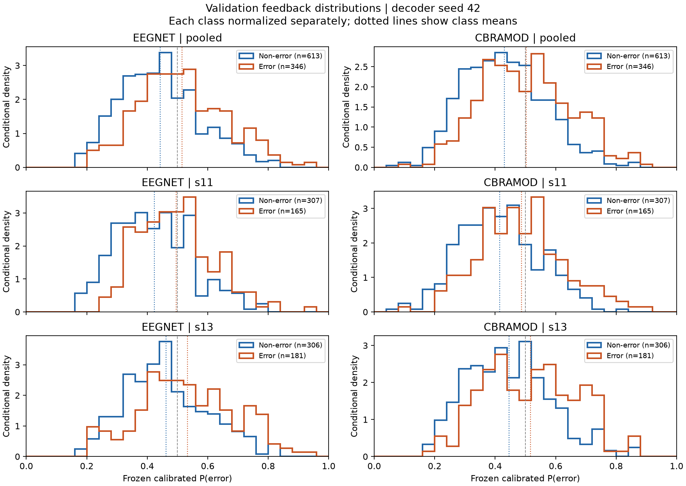
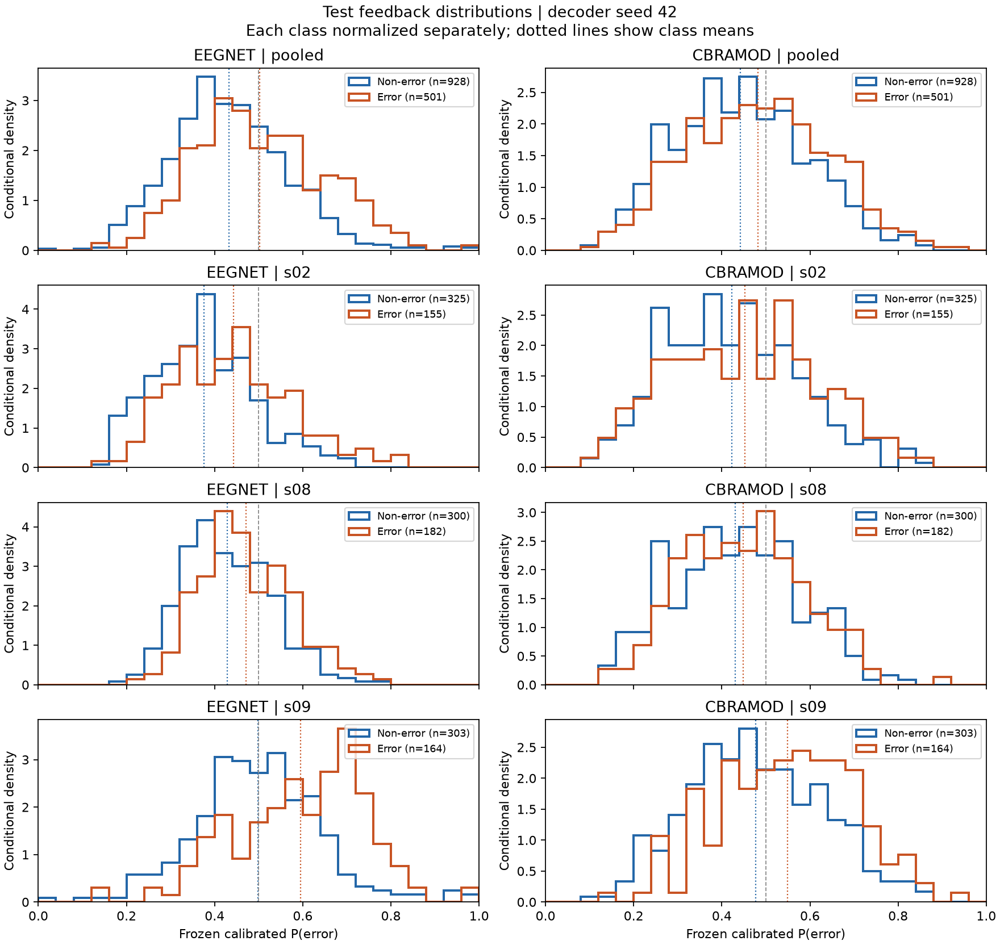

# Frozen EEG feedback quality

Source: [eeg-stage1-20261101-bccbb8a](https://github.com/ywen0511/CSCI642-Project/releases/tag/eeg-stage1-20261101-bccbb8a). Decoder seed 42 only.

The constant baseline is fitted only from the training labels: 1208/3434 = **0.351776354**. It is applied unchanged to validation and test, including every participant. It does not use evaluation prevalence.

## Probability scores

Lower Brier and NLL are better. Negative deltas mean improvement over the constant baseline. NLL uses natural logarithms and probabilities clipped to [1e-12, 1-1e-12]. AUROC uses average ranks for ties. Metrics are recomputed from the released 10-significant-digit CSVs: AUROC/Brier tolerance is 1e-7 and NLL tolerance is 1e-5 because rounding extreme probabilities amplifies log-loss differences. Exact differences are recorded in verification.json.

| split | model | probability | n | auroc | brier | nll | delta_brier_vs_constant | delta_nll_vs_constant |
| --- | --- | --- | --- | --- | --- | --- | --- | --- |
| validation | eegnet | raw | 959 | 0.644726 | 0.230645 | 0.655033 | -0.000057 | 0.000983 |
| validation | eegnet | calibrated | 959 | 0.644726 | 0.228875 | 0.649482 | -0.001827 | -0.004568 |
| validation | cbramod | raw | 959 | 0.637908 | 0.321245 | 1.729482 | 0.090542 | 1.075432 |
| validation | cbramod | calibrated | 959 | 0.637908 | 0.227186 | 0.645829 | -0.003517 | -0.008221 |
| validation | constant_train_prevalence | constant | 959 | 0.500000 | 0.230703 | 0.654050 | 0.000000 | 0.000000 |
| test | eegnet | raw | 1429 | 0.637032 | 0.227652 | 0.655756 | -0.000027 | 0.007939 |
| test | eegnet | calibrated | 1429 | 0.637032 | 0.227047 | 0.649499 | -0.000632 | 0.001682 |
| test | cbramod | raw | 1429 | 0.572538 | 0.363204 | 2.218724 | 0.135525 | 1.570907 |
| test | cbramod | calibrated | 1429 | 0.572538 | 0.244478 | 0.684273 | 0.016798 | 0.036456 |
| test | constant_train_prevalence | constant | 1429 | 0.500000 | 0.227679 | 0.647817 | 0.000000 | 0.000000 |

## Label-conditional feedback

Mean gap = mean P(error) on error trials minus mean P(error) on non-error trials. Positive gaps describe useful direction, not causal effects or evidence that RL will improve. Both classes overlap substantially.

| split | subject_id | model | mean_nonerror | mean_error | mean_gap |
| --- | --- | --- | --- | --- | --- |
| validation | pooled | eegnet | 0.442979 | 0.515641 | 0.072662 |
| validation | s11 | eegnet | 0.423793 | 0.496155 | 0.072363 |
| validation | s13 | eegnet | 0.462228 | 0.533404 | 0.071176 |
| validation | pooled | cbramod | 0.430353 | 0.502636 | 0.072283 |
| validation | s11 | cbramod | 0.415446 | 0.487485 | 0.072039 |
| validation | s13 | cbramod | 0.445308 | 0.516448 | 0.071139 |
| test | pooled | eegnet | 0.432741 | 0.502544 | 0.069803 |
| test | s02 | eegnet | 0.375744 | 0.442239 | 0.066495 |
| test | s08 | eegnet | 0.428169 | 0.470675 | 0.042506 |
| test | s09 | eegnet | 0.498402 | 0.594906 | 0.096504 |
| test | pooled | cbramod | 0.442606 | 0.482612 | 0.040006 |
| test | s02 | cbramod | 0.422346 | 0.452342 | 0.029996 |
| test | s08 | cbramod | 0.429832 | 0.448888 | 0.019056 |
| test | s09 | cbramod | 0.476983 | 0.548647 | 0.071663 |

Full per-participant metrics: [probability_metrics.csv](probability_metrics.csv). Counts, sample SD (ddof=1), means, 5/25/50/75/95 percentiles and fraction in [0.45, 0.55]: [conditional_probability_stats.csv](conditional_probability_stats.csv). Quantiles use linear interpolation.

## Interpretation and scope

- EEGNet seed 42 is only slightly better than the constant baseline in test Brier; its test NLL is worse. CBraMod is worse than the baseline on both probability scores. AUROC measures ranking and does not establish calibrated probabilities.
- The baseline is a diagnostic comparator, not a replacement selected using the test set. No model, seed, temperature, threshold or feedback table was changed.
- Validation participants were already used for decoder selection and calibration. Their scores are not unbiased final estimates; subsequent RL tuning may use them under the agreed protocol.
- These are descriptive pooled and participant results on one frozen split. Five training seeds are not five independent participant samples. No significance claim is made.
- The plots describe the stored error/non-error trial library. RL action-to-label mapping, reward transformation, feedback frequency, sampling policy and RL random seeds belong to the later stage.
- [verification.json](verification.json) records the downloaded-file checks and reproduction environment for this analysis. This CPU check does not independently verify checkpoint loading or continuation; original GPU verification is reported separately in [artifact_index.md](../artifact_index.md).
